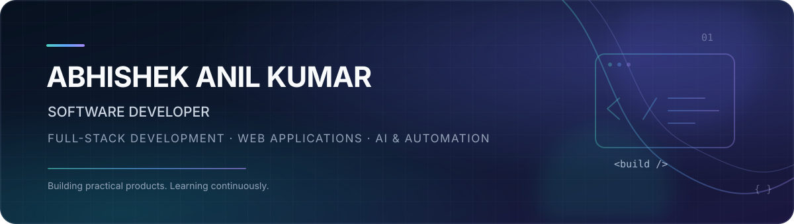

  

  
  
  

<h3 align="center">Software Developer · Full-Stack Development · AI-Powered Applications</h3>

  I build responsive web experiences and practical software products — from polished user interfaces to full-stack applications.

---

## 👋 About Me

I'm **Abhishek Anil Kumar**, a software developer with **1 year of professional web development experience**, currently pursuing my **Master of Computer Applications (MCA)**. I enjoy turning ideas into useful applications, writing clean and maintainable code, and continuously learning modern development tools.

- 💻 Interested in **Software Engineering, Full-Stack Development, and Application Development**.
- 🧩 Enjoy building responsive interfaces, REST APIs, and data-driven applications.
- 🤖 Exploring practical applications of **AI, automation, and data analysis**.
- 🌱 Currently strengthening my skills in React, JavaScript, backend development, SQL, and problem-solving.
- 📍 Bengaluru, India.

---

## 🚀 Featured Projects

<table>
  <tr>
    <td width="50%" valign="top">
      <h3>🎯 SkillBridge</h3>
      
<strong>Personalized Learning & Skill Gap Analysis Platform</strong>

      
A learning platform that helps learners evaluate their readiness for a target role by comparing resume skills with job requirements.

      <ul>
        <li>Resume and job-description parsing</li>
        <li>Skill matching and readiness scoring</li>
        <li>Timed assessments and progress dashboard</li>
      </ul>
      
<strong>Built with:</strong> React · Tailwind CSS · Vite · Node.js · Express · MongoDB · Python

      

        
        
      

    </td>
    <td width="50%" valign="top">
      <h3>📦 Mercura AI</h3>
      
<strong>AI-Driven Inventory Intelligence for Merchants</strong>

      
An inventory intelligence platform designed to help small retailers understand stock risk, identify dead stock, and make better replenishment decisions.

      <ul>
        <li>Inventory and working-capital insights</li>
        <li>Demand classification and dead-stock risk scoring</li>
        <li>Spreadsheet, barcode, and AI-assisted invoice ingestion</li>
      </ul>
      
<strong>Built with:</strong> JavaScript · React · Tailwind CSS · Python · PostgreSQL · Supabase · Gemini AI

      

    </td>
  </tr>
  <tr>
    <td width="50%" valign="top">
      <h3>🗳️ PotentPolicy</h3>
      
<strong>Full-Stack E-Consultation & Policy Governance Platform</strong>

      
A multi-tenant platform for institutions to organise policy consultations and collect structured feedback from stakeholders.

      <ul>
        <li>Organisation onboarding and role-based workspaces</li>
        <li>Stakeholder directory and bulk roster imports</li>
        <li>Consultation campaigns and secure participation workflows</li>
      </ul>
      
<strong>Built with:</strong> React · Vite · Node.js · Express · PostgreSQL · Supabase

      

    </td>
    <td width="50%" valign="top">
      <h3>📊 Data Analysis Projects</h3>
      
<strong>Exploratory Analysis & Data Visualisation</strong>

      
A collection of notebook-based projects exploring datasets and extracting useful insights.

      <ul>
        <li>Ferns and Petals sales analysis</li>
        <li>Hotel booking and cancellation analysis</li>
        <li>Diwali sales, demographic, and medical data projects</li>
      </ul>
      
<strong>Tools:</strong> Python · Jupyter Notebook · Excel · Data Visualisation

      

    </td>
  </tr>
</table>

---

## 💼 Experience

**Web Developer Trainee · Indegene**  
*1 year · Bengaluru, India*

- Developed responsive web pages using semantic HTML5 and modular CSS, maintaining consistent UI across desktop and mobile breakpoints.
- Built **30+ pixel-accurate HTML email templates** from Figma and PSD designs, reducing post-QA defects by **30% across 10+ email clients**.
- Supported on-schedule Veeva Sandbox deployments for pharmaceutical marketing campaigns, collaborating with design, QA, and content teams.

---

## 🛠️ Tech Stack

  

| Area | Technologies |
|---|---|
| **Frontend** | HTML5, CSS3, JavaScript, React, Tailwind CSS, Vite |
| **Backend** | Node.js, Express.js, Python, REST APIs |
| **Databases** | MongoDB, PostgreSQL, SQL |
| **Data & Analysis** | Python, Jupyter Notebook, Excel, data visualisation |
| **Tools & Workflow** | Git, GitHub, VS Code, n8n |

---

## 🎓 Education

- **Master of Computer Applications (MCA)** — BMS Institute of Technology and Management *(Pursuing)*
- **Bachelor of Computer Applications (BCA)** — Presidency College, Bengaluru

---

## 📈 GitHub at a Glance

  
  

  

---

## 🤝 Let's Connect

I'm interested in opportunities where I can contribute to building reliable web applications, learn from experienced teams, and grow as a software developer.

  
  

Thanks for visiting my profile. Feel free to explore my repositories and connect!

